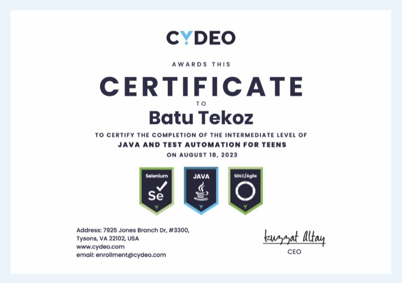

# 👋 Hi, I'm Batu Teköz

**C++ & Rust Systems Developer**

High-performance networking · Game servers · Desktop tools · Security-oriented backends

---

## 🚀 About Me

I build **low-level, high-performance systems**: networking libraries, game servers, multiplayer games, desktop launchers and secure backends.

I like working close to the metal: squeezing out performance, designing architectures that scale, and understanding how systems behave under load.

---

## 🔧 Tech Stack

| Area | Tools |
|---|---|
| **Languages** |      |
| **Networking** |    |
| **Graphics & Desktop** |     |
| **Backend & Data** |     |

---

## 🧠 Focus Areas

- High-performance C++ and Rust systems
- Multiplayer networking architecture
- Game servers and protocol implementation
- Low-level performance optimization
- Secure and scalable backend design

---

## 📂 Projects

### 🏎️ Racing & Games

<table>
<tr>
<td width="50%" valign="top">

#### 🏁 [XoidDrift](https://github.com/batutekoz77/XoidDrift) · *Flagship*
  

An **online drift game for Windows**, built from scratch in C++ and Direct3D 11 to run smoothly on weak PCs.

- 240 Hz car physics: four-tire model, clutch kick, handbrake drifting
- Steering wheel support with force feedback
- 1–8 player rooms on a dedicated ENet server, 30 Hz sync with interpolation
- Argon2id accounts, e-mail 2FA, encrypted traffic, cheat-checked car states
- Own UI library (single draw call) and encrypted asset packer
- My first vibe-coded project, built with Claude Code

</td>
<td width="50%" valign="top">

#### 🛞 [Xoid Content Manager](https://github.com/batutekoz77/XoidContentManager) · *New*
  

A **lightweight Assetto Corsa launcher and content manager**, focused on drifting and maximum in-game FPS.

- Rust backend: the UI window is closed while you drive, only a tiny low-priority process stays
- Parallel car / track / skin scan (86 cars, 17 tracks in ~45 ms)
- Safe mod installer for `.zip` / `.7z` / `.rar` with path-traversal protection
- FPS measurement and **Auto-tune** graphics profiles from a real benchmark run
- Online server browser plus **one-click room hosting** (AssettoServer, UPnP, firewall)
- Custom server plugins: vote kick, collision guard, chat, minimap
- Discord Rich Presence, Spotify control, MCP server for AI assistants, auto-update

</td>
</tr>
</table>

---

### 🌱 Growtopia Tools

<table>
<tr>
<td width="50%" valign="top">

#### 🤖 [GrowtopiaBot](https://github.com/batutekoz77/GrowtopiaBot)
 

A fast, lightweight **multi-bot manager**: run as many bots as you want from one modern panel, no game client needed.

- Control each bot by hand or automate with **Lua 5.4** scripts
- Connect, warp, chat, drop, walk, punch / place
- Send raw packets and react to in-game events

</td>
<td width="50%" valign="top">

#### 🌐 [GrowtopiaProxy](https://github.com/batutekoz77/GrowtopiaProxy)
 

A low-level ENet proxy for **real-time packet inspection and modification** between client and server.

- Packet interception and forwarding
- Read, edit and send custom packets
- Hook-based architecture
- Protocol-level debugging tools

</td>
</tr>
</table>

---

### 🔌 Networking & Game Servers

<table>
<tr>
<td width="50%" valign="top">

#### 🔥 [XoidPeer](https://github.com/batutekoz77/XoidPeer)
 

A modern **C++20 networking library on top of ENet** for production-grade multiplayer systems.

- Clean, zero-dependency public API
- Packet validation and rate limiting
- Thread-safe server / client model

</td>
<td width="50%" valign="top">

#### ⛏️ [XoidCraft](https://github.com/batutekoz77/XoidCraft)
 

A **Minecraft 1.8.9 (protocol 47) server** written from scratch, with no external libraries.

- Raw WinSock2 TCP layer, multi-threaded
- Packet framing and protocol state handling
- Custom chunk serialization, world loading and saving

</td>
</tr>
</table>

---

### 🗄️ Web & Backend

<table>
<tr>
<td width="50%" valign="top">

#### 🏦 [XoidBank](https://github.com/batutekoz77/XoidBank)
  

A **secure banking web app** with mandatory 2FA and Dutch BSN validation.

- 2FA that cannot be bypassed, even with "remember me"
- Tiered sessions: pending → full → remember token
- BSN check with the real 11-proef algorithm
- Rate limiting and flood protection on sensitive endpoints

</td>
<td width="50%" valign="top">

#### 🏢 [Real World SQL Web](https://github.com/batutekoz77/Real-World-SQL-Web)
  

An **enterprise-style web app** for announcements, task management and an employee database.

- Authentication system
- Task and announcement management
- Database-driven, full C++ backend

</td>
</tr>
</table>

---

## 🏆 Certificate

  

---

## 📫 Contact

- 📧 Email: contact@batutekoz.nl
- 💬 WhatsApp: +31622266035

---

**"Build systems that scale, not scripts that work."**

